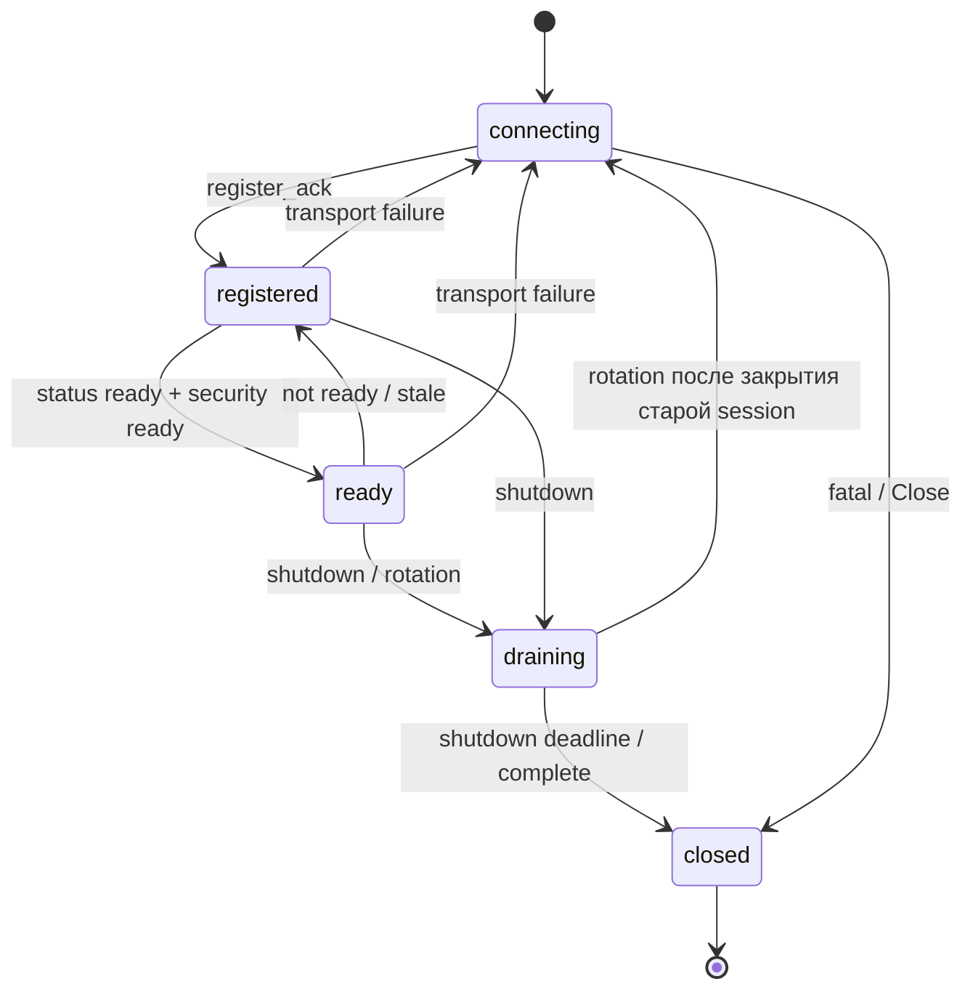

# Outgate Tunnel Protocol

| Поле | Значение |
| :--- | :--- |
| Статус | Draft; контракт для реализации, не отчёт о работающем адаптере |
| Protocol major / minor | 1 / 1; minor 0 поддерживается без новой capability |
| Дата | 2026-11-21 |
| Требования | [requirements.md](requirements.md), разделы 3–6 |
| Control schema | [protocol.schema.json](protocol.schema.json), JSON Schema Draft 2020-12 |
| Реализация | Собственный код Outgate, напрямую quic-go/http3 и WebSocket-библиотека; reverst не используется |
| Архитектурный референс | Рассмотренная ревизия reverst и история решения — [upstream.md](upstream.md), не dependency |

Термины **MUST**, **MUST NOT**, **SHOULD** задают обязательность контракта. Собственные wire-константы Outgate ниже являются проектным решением. QUIC layout является собственным Draft-контрактом Outgate, разработанным с учётом рассмотренного архитектурного паттерна; код reverst не импортируется/не копируется и fork не создаётся; его работоспособность с выбранными Go/quic-go, включая Windows, должна быть подтверждена сквозным spike до реализации этапа 2. Schema/fixtures не заменяют этот тест. При обнаружении несовместимости меняются одновременно этот документ, ТЗ, schema и fixtures; молчаливая подмена wire-формата запрещена.

Идентификаторы этого Draft используют имя Outgate. Совместимость с прежними идентификаторами до переименования не поддерживается; опубликованных релизов протокола пока нет.

## 1. Участники и границы

- **S** — SDK сервисного экземпляра, инициатор TCP/QUIC соединения.
- **G** — gateway, инициатор прикладных запросов в обратном туннеле.
- Внешний HTTP-клиент и application WebSocket — не участники control protocol.
- Регистрация, credentials, readiness, маршрутизация и ошибки общие для QUIC/WSS. Byte framing, flow control и отмена адаптируются отдельно.
- QUIC listener использует UDP, WSS — TCP; транспорт выбирается явно, без fallback. TLS минимум 1.3, проверка server CA/hostname обязательна; production требует service mTLS и deployment grant. 0-RTT отключён.
- Admin API, discovery/revocation HTTPS API, issuer/OIDC и SQL migration protocol не передаются как control-сообщения. Их полномочия/устойчивость определяет ТЗ. Этот документ закрепляет их связь с туннельной доставкой и подписью.

## 2. Кодирование и примитивы

Control object имеет обязательный `type`, закрытый набор основных полей и необязательный `extensions` object. Допустимые поля каждого типа полностью задаёт schema. Duplicate JSON keys, invalid UTF-8, NaN/Infinity и неизвестные основные поля отклоняются. Unknown optional extensions допускаются только без security effects; обязательная функциональность согласуется capability, а не угадывается по extension.

| Тип | Wire / ограничения |
| :--- | :--- |
| u64 | JSON decimal string `0` либо `[1-9][0-9]*`, численно ≤ 18446744073709551615 |
| stream_id | u64 > 0; G выдаёт монотонно от 1, без reuse в одной session |
| session_id | 16 random bytes, canonical base64url без padding, 22 ASCII chars |
| service_id / instance_id | case-sensitive `[A-Za-z0-9][A-Za-z0-9._-]{0,127}` |
| mount_id | `[a-z][a-z0-9_-]{0,63}` |
| version | 1–128 UTF-8 bytes, не blank, без control characters; не автоматически SemVer |
| timestamp | integer Unix seconds UTC, 0…253402300799 |
| duration | control wire — integer milliseconds; YAML duration strings не используются |
| code | стабильный lower_snake_case ASCII identifier ≤ 64 chars |
| detail | безопасный UTF-8 текст ≤ 512 bytes, без credentials/claims/SQL |
| headers | ordered array `[["name","value"], ...]`, имена lower-case HTTP token; повторения сохраняются |
| raw_request_uri | origin-form escaped path + optional raw query, начинается `/`, ≤ 8192 bytes |

Нормализация/escaping path соответствуют ТЗ: один decode только для route selection; raw escaped bytes для подписи и доставки; decoded separators, backslash, dot segments и неоднозначности отклоняются. Query не сортируется/не декодируется. Фрагмент/absolute-form/authority-form в ordinary request запрещены. Header names ASCII; values не содержат CR/LF/NUL/прочие CTL кроме HTAB. Host передаётся отдельно, не как повторяемый header. Hop-by-hop поля обычного HTTP удаляются по ТЗ; только application WebSocket handshake сохраняет нужные Connection/Upgrade и согласованные extension headers; различающиеся Content-Length и framing ambiguity не допускаются. Бинарные тела никогда не кодируются JSON/base64.

Schema проверяет структуру, но не все межполевые связи, UTF-8 byte limits, u64 overflow, полномочия или состояния: реализация обязана выполнить также семантические проверки этого документа. `null` разрешён только там, где прямо указан; отсутствие optional field не эквивалентно произвольному null.

## 3. Version negotiation и регистрация

### 3.1. Capabilities

В v1.0 оба участника поддерживают `streaming`, `cancellation`, `duplex_websocket`, `bounded_flow_control`. Они MUST присутствовать и в capabilities, и в required_capabilities register/ack. Дополнительные capabilities v1.0: `mount_discovery`, `credential_generation`; они обязательны для сессии, использующей соответствующую функцию. Формат feature ID: `[a-z][a-z0-9_]{0,63}`, список без дублей, до 32 значений.

`protocol_version` обязан равняться 1. Minor согласуется как minimum двух поддерживаемых minors, capabilities — intersection. Required набор любой стороны обязан входить в intersection. Иначе G отправляет nack unsupported_protocol_version и закрывает session без публикации. S проверяет ack теми же правилами. Несовместимый major не вызывает попытку другого транспорта. Сейчас minor=1; minor 0 остаётся совместимым. В minor 1 добавлена optional capability `quic_quiescent_fence`, не входящая в baseline и WSS. Её использование требует negotiated minor ≥1 и присутствия capability в capabilities и required_capabilities обеих сторон. Без неё native graceful drain этого профиля не используется; отсутствие capability не разрешает fallback транспорта.

### 3.2. Register

Первое control-сообщение S → G — register. Credential передаётся отдельно по §4/§5, никогда не в metadata/extensions.

```json
{"type":"register","protocol_version":1,"protocol_minor":0,"capabilities":["streaming","cancellation","duplex_websocket","bounded_flow_control","mount_discovery"],"required_capabilities":["streaming","cancellation","duplex_websocket","bounded_flow_control","mount_discovery"],"service_id":"reports-service","instance_id":"reports-1","version":"1.0.0","paths":["/api/v2"],"mounts":{"api":"/api/v2"},"path_mode":"strip","rewrite_mount_headers":true,"metadata":{},"readiness_check_configured":true,"max_concurrent_requests":100}
```

Обязательны все поля примера, кроме mounts/metadata/extensions/credential_generation. `mounts` отсутствует либо непустой map; каждый value — точный элемент paths. Path mode preserve/strip, rewrite явно указан. Maximum paths 32, mounts 32; дубли нормализованных paths отклоняются. Metadata ≤32 entries, key≤64/value≤1024 bytes и sum(key/value UTF-8 bytes)≤8192. Production instance_id задаётся явно и совпадает с SAN/grant; max_concurrent_requests >0. Credential generation — positive u64, при atomic provider требуется capability credential_generation.

Проверки: TLS identity → credential binding/expiry/revocation → protocol/limits → service/path/mount permissions → conflicts/duplicate instance → атомарная регистрация всех путей. Никакая частичная регистрация не допускается; rejected register не создаёт discovered version. Отсутствие активированных путей не делает регистрацию невалидной: production paths могут остаться pending.

При атомарной ротации gateway связывает `credential_generation` с выданным grant и возвращает принятое значение в `register_ack`. Порядок выдачи, проверка SPKI и подготовка пары описаны в [контракте credentials](credentials.md).

### 3.3. Ack / nack

G → S `register_ack` содержит все перечисленные schema поля:

| Поле | Значение |
| :--- | :--- |
| protocol_version, protocol_minor | согласованные версии |
| capabilities, required_capabilities | согласованный набор и обязательный набор G |
| session_id | новый random token; старый после реконнекта недействителен |
| route_revision | текущая монотонная service route revision |
| paths | array `{path,state}`; state active/pending/retired; полный принятый набор |
| limits | фактические control/chunk/window/header/inflight/buffer лимиты |
| timeouts | register/write/cancel/status/drain deadlines, milliseconds |
| readiness | `{required, interval_ms, timeout_ms, failure_threshold, success_threshold, stale_after_ms}` |
| credential_expires_at | minimum cert/grant expiry в production; null только development |
| ready_not_before | earliest timestamp после security recovery barrier, не обещание готовности |
| credential_generation | accepted generation либо отсутствие при static credentials |

`limits` содержит max_control_bytes (≤65536), max_chunk_bytes (≤32768), initial_window_bytes (≤65536), max_header_bytes (≤32768), max_raw_uri_bytes (≤8192), max_inflight (≤ min gateway policy/SDK advertised limit), buffer_bytes (≤ tunnel configured budget). Window target не является выданным credit. Значения >0; фактическое окно каждого направления задают start/window_update. Timeouts: register_ms=10000, write_ms=10000, cancel_ack_ms=10000, status_interval_ms=5000, status_stale_ms=15000, drain_ms=30000 по умолчанию. G может ужесточить лимиты, но не расширить заявленные S максимумы. Ack сам MUST умещаться в исходный control limit.

Ack отправляется только после устойчивой фиксации требуемого control state/outbox. До его отправки G не назначает запросы. После ack S посылает instance_status; G не выбирает S, пока ready=false/stale или barrier не завершён. Возможность записи ack не делает сервис primary и не активирует pending paths. Ack failure исключает session из выбора, не освобождая durable ownership.

Nack: `{type:"register_nack",code,detail,retryable}`. Retryable MUST совпадать с таблицей §12, не выбирается клиентом. После nack нет второго register в той же connection; повтор использует новое соединение и policy backoff. Незащищённая/TLS ошибка может вообще не иметь protocol response.

## 4. WSS transport

### 4.1. Bootstrap

1. S подключается к configured hostname:port/path (`/tunnel` default), TLS 1.3; production mTLS до Upgrade.
2. Upgrade — HTTP/1.1 GET, `Sec-WebSocket-Protocol: outgate.tunnel.v1`; G обязан вернуть этот subprotocol. Tunnel permessage-deflate отключён. Origin браузера не даёт полномочий; обычные браузерные соединения к listener не разрешаются.
3. `Authorization: Bearer <credential>`: development service token или production `grant_id.secret`. Проверка credential до 101, повторная точная binding-проверка после register. Credential не в URL, не в Cookie и не пересылается handler. Pre-Upgrade auth failure — 401, path/method mismatch — 404/405, unsupported subprotocol — 400.
4. После 101 первый text message — register. Register timeout 10s. Пустой/неподдерживаемый первый message — protocol_error.
5. После ack работают text control messages и binary chunks; frame fragmentation разрешена, но лимит действует на assembled message без неограниченного буфера. Client frames маскируются по RFC 6455.

### 4.2. Binary layout

| Offset | Bytes | Поле |
| :--- | :--- | :--- |
| 0 | 1 | version = 1 |
| 1 | 1 | kind: 1 request body, 2 response body, 3 app WebSocket к handler, 4 от handler |
| 2 | 2 | flags = 0, unsigned big-endian |
| 4 | 8 | logical stream_id, unsigned big-endian, >0 |
| 12 | 4 | payload length, unsigned big-endian |
| 16 | length | raw payload |

Один assembled binary message содержит ровно один chunk. Payload length MUST быть >0 и ≤ negotiated max_chunk_bytes; EOF — отдельный end control. Общая длина точно 16+length. Неизвестный kind/version, ненулевые flags, переполнение/неверная длина или отсутствующий stream — protocol_error до выделения по объявленной длине. Kind 1/3 идут G → S; 2/4 — S → G. Stream kind HTTP/WebSocket не может изменяться после открытия.

Пример request body `abc`, stream 1: `01010000000000000000000100000003616263` (19 bytes). Проверяемые positive/negative cases: [wss-frames.json](../tests/fixtures/protocol/v1/wss-frames.json).

### 4.3. Writer, liveness и бюджеты

Один writer сериализует сообщения, сохраняя причинный порядок для каждого stream; приоритет control не позволяет end обогнать собственные queued chunks. Между готовыми streams — fair scheduling. Reader не ждёт handler/body consumer, читает control независимо от consumption body. Начальное окно резервирует память до выдачи; overload stream start возвращает 429, а не неограниченную очередь.

WebSocket Ping каждые 15s, payload — monotonically increasing 8-byte big-endian ping counter; Pong обязан повторить payload. Pong timeout 10s, два последовательных пропуска → connection failure. Успешный Pong сбрасывает счётчик. Application bytes/pong приложения не заменяют tunnel Pong. Frame write timeout 10s; нельзя бросить частично записанный frame и продолжать ту же session. Session control queue максимум 256 messages и 256 KiB; переполнение — protocol_error/connection close. Эти отдельные лимиты входят в общий process memory budget.

## 5. QUIC reverse HTTP/3 transport

### 5.1. Самостоятельный reverse profile

Результаты проверки транспорта и статус платформенной приёмки приведены в [отчёте QUIC spike](quic-spike.md).

Outgate реализует собственный bootstrap: S открывает регистрационный bidi stream перед reverse HTTP/3, G обрабатывает его отдельно от HTTP/3. Транспортные операции выполняются напрямую через выбранную quic-go, без модулей/файлов/бинарников reverst. Рассмотренный похожий паттерн reverst описан только в [истории референса](upstream.md); его MessagePack codec/ALPN не заимствуются, wire compatibility не требуется.

Outgate v1 задаёт собственный ALPN `outgate-tunnel/1`. Это частный reverse profile, а не публичный стандартный `h3` endpoint: S — QUIC client, но HTTP/3 application server; G — QUIC server, но HTTP/3 application client. Это проектный reverse mapping, который требует собственного compatibility spike. Применяемая HTTP/3 реализация должна поддерживать эту обратную роль. Нельзя объявлять wire совместимым с произвольным browser HTTP/3 client.

### 5.2. Control carrier

- Первое S-initiated bidirectional stream — QUIC stream ID 0. Только он зарезервирован под Outgate control, остаётся открытым всю session. G принимает/проверяет его до подключения HTTP/3 machinery; S не открывает другие bidi streams. Неожиданный bootstrap stream/первое сообщение закрывает connection с Outgate protocol error.
- Первый frame: magic ASCII `Outgate1` (8 bytes), credential kind uint8 (1 development bearer / 2 production grant), credential length uint16 big-endian (1…4096), затем ровно credential UTF-8 bytes. Передача только после TLS handshake, не 0-RTT. Configured production отвергает credential kind=1, development — kind=2; peer не выбирает security mode. После этого нет magic/credential повторно.
- Далее в каждом направлении: uint32 big-endian length (1…65536), затем ровно столько UTF-8 JSON control bytes, без newline/sentinel. JSON nesting depth максимум 32, действует и для WSS. Первый S object register, первый G object ack/nack. Несколько JSON frames могут идти в одном QUIC read; частичное чтение собирает только ограниченный текущий frame. Нельзя смешать этот carrier с HTTP/3 DATA/SETTINGS или QPACK.
- В registered carrier передаёт status/drain/unregister/reconnect сообщения §8; обычные HTTP start/body/end/window_update сюда не помещаются. Управляющие half-closes не используются: потеря/FIN/reset carrier делает всю session недействительной.
- После ack S запускает reverse HTTP/3 server. G использует существующий connection, без нового dial; G-initiated bidi stream IDs 1,5,9,… несут reverse HTTP requests. HTTP/3 control/QPACK используют соответствующие native unidirectional streams; типы 0x00/0x02/0x03 сохраняются библиотекой, push отключён. Outgate не открывает дополнительных uni streams и не меняет QUIC stream IDs ради JSON IDs. Этот private reverse mapping, stream 0 exclusion и QPACK должны быть подтверждены spike, не только serialization unit test.

### 5.3. HTTP и отмена

Каждый HTTP-запрос — отдельный reverse HTTP/3 request stream с обычными headers/DATA/FIN. G добавляет transport-only `x-tunnel-request-id` с logical stream_id; S проверяет уникальность в session и удаляет его до handler/verifier. Внешние одноимённые поля удаляются G; это не пользовательская идентичность и не замена signed instance binding. Host/escaped URI и подписанные headers восстанавливаются без semantic rewriting.

HTTP/3 stream reset/STOP_SENDING отменяют соответствующий запрос/направление; H3_REQUEST_CANCELLED=0x10c используется для штатной отмены, остальные HTTP/3 ошибки интерпретируются HTTP/3 библиотекой. Сбой одного запроса не закрывает исправный connection. Native flow control заменяет WSS window_update; bounded receive/write budgets и cleanup сохраняются. Нельзя ждать полного body ради проверки подписи/лимита. После первых переданных bytes business retry запрещён, независимо от reset/GOAWAY.

### 5.4. Internal CONNECT приложения WebSocket

G открывает reverse HTTP/3 CONNECT с фиксированным `:authority=outgate-app-channel.invalid:443`, без :path/:scheme/:protocol, `x-tunnel-request-id` и только внутренними transport headers. S допускает это только на уже registered reverse connection; authority другого назначения/внешняя сеть/произвольный TCP запрещены. Это не public proxy и не RFC 9220 browser Extended CONNECT.

Ответ 200 означает только создание bounded byte channel к виртуальному HTTP/1.1 server SDK. По CONNECT DATA сначала идёт исходный HTTP/1.1 application WebSocket handshake с нужным прикладным Host, затем его ответ. Именно внутренний ответ 101 приводит к внешнему 101; transport 200 не выдаёт приложению доступ. Внутренний не-101 передаётся как обычный HTTP response с потоковым body, без повторного назначения/fallback; channel затем закрывается. Ошибка создания channel до inner handshake — 502/504. Application request signatures проверяются по inner HTTP request, не по fixed CONNECT authority; outer CONNECT не содержит второго outgatecall/outgategateway и не расходует отдельный user nonce.

После inner 101 payload — непрозрачные RFC 6455 bytes, включая control frames, masking и extensions. Библиотека обрабатывает inner handshake/HTTP framing, но не должна изменять app frames. FIN закрывает одно направление, reset отменяет channel; cancel/revoke закрывает оба. Keepalive QUIC 15s, idle 45s; JSON ping/pong не используются.

## 6. Потоковый HTTP через WSS

### 6.1. Start и credit

`request_start` G → S: stream_id, method, raw_request_uri, host, headers и response_credit (u64 bytes, выданные G для response body). Request body initial credit равен 0: G не отправляет его до window_update от S. S резервирует request buffer и может выдать request credit сразу, ещё до запуска handler. Это исключает неявное выделение окна, когда receiver перегружен.

`response_start` S → G: stream_id, status 200…599, headers. Поле initial request credit в response_start не требуется — он уже выдан window_update. 101 разрешён только внутри raw WebSocket handshake, не как ordinary response_start. Для HEAD/204/304 body payload запрещён, но response_end обязателен. Контроль Content-Length учитывает HTTP semantics этих статусов: представление может иметь длину без передаваемого body.

`window_update` receiver → sender: stream_id, direction=request_body|response_body|websocket_to_handler|websocket_from_handler, credit positive u64. Credit складывается с остатком, не заменяет его; проверить overflow и max reserved memory. При HTTP открытии response_credit/первое window_update ≤ initial_window_bytes; последующие выдачи ограничены потреблёнными bytes и budget. Нулевой credit не посылается. После фактической передачи bytes downstream receiver возвращает credit; простое read в очередь не является consumption. Ready streams/SDK concurrency/memory ограничиваются минимумом всех лимитов.

### 6.2. EOF и ранний ответ

`request_end` / `response_end`: stream_id и bytes_sent (u64 суммарных payload bytes этого направления). Сумма обязана совпадать с реально отправленными chunks и применимым Content-Length. Нулевое тело — start → end без binary messages. End означает EOF, не самовольную отмену другого направления. Response может начаться и завершиться до request_end.

S может вернуть 429/другой ранний ответ и послать cancel scope=request_body, продолжая response. G останавливает upload, но не уничтожает response. Оба end либо terminal cancel all освобождают stream. SSE bytes flush-ятся немедленно в пределах кредита, без ожидания накопления chunk размера max. End/response_start не обходят ordered writer.

### 6.3. Cancel и гонки

`cancel`: stream_id, cancel_id (u64 >0, monotonically increasing отдельно у каждого отправителя), scope, code. Scope request_body/response_body/all; для app WebSocket только all. Получатель обрабатывает context cancellation, перестаёт формировать data соответствующего scope, удаляет queued data/end (а также ещё не отправленный response_start отменяемого response), и отправляет `cancel_ack` с тем же stream_id/cancel_id/scope после уже начатого frame. В ack никто не подтверждает бизнес-откат.

Инициатор до ack сохраняет bounded ledger оставшегося ранее выданного credit и отбрасывает только допустимые in-flight bytes. После ack запрещены bytes/end данного scope. Если end был отправлен до получения cancel, ack всё равно посылается; инициатор принимает такой end до ack. При одновременной отмене каждая сторона подтверждает противоположный cancel_id; два cancel не заменяют два ack. Повтор cancel того же отправителя с тем же ID/payload идемпотентен только пока ledger существует; разные payload при одинаковом ID — protocol_error. Ack deadline 10s, затем connection закрывается.

Для завершённых/отменяемых IDs ledger ограничен 2048 entries/tunnel и 16 MiB вместе с остальным tunnel budget; новые streams отклоняются, если безопасное состояние не помещается. Нельзя забыть credit до ack ради освобождения места. WSS start messages идут в возрастающем порядке без пропусков ID, поэтому receiver хранит общий opened watermark. Для уже завершённого ID ≤ watermark late cancel получает stateless ack без повторного handler вызова и без выделения ledger; ID > watermark — protocol_error. Terminal data для закрытого ID всё равно запрещены. Активный cancel ledger хранится только до ack; нормальный завершённый HTTP stream не требует вечного tombstone. Данные после end/ack/неизвестного start — session protocol error. Поздняя отмена локального context после полного освобождения stream не посылается peer.

## 7. WSS application WebSocket

G → S websocket_open: stream_id, method=GET, raw_request_uri, host, headers, from_handler_credit. S → G websocket_open_ack: stream_id, to_handler_credit. Credit выдаётся из реального budget (может быть 0). Ack только открывает byte channel и не подтверждает пользовательскую аутентификацию.

После open_ack G отправляет kind=3 raw HTTP/1.1 handshake; S виртуальный HTTP/1.1 server вызывает обычный handler и возвращает kind=4 raw HTTP response. Metadata open обязана совпасть с inner method/URI/Host/end-to-end headers (имена headers case-insensitive, порядок разных имён незначим, порядок повторных значений одного имени сохраняется); несоответствие — protocol_error, не альтернативный unsigned HTTP-запрос. Для отказа до открытия channel S отправляет response_start/end этого ID с обычным error body, не open_ack. После open_ack HTTP response существует только внутри byte channel, не дублируется response_start.

G разбирает ограниченные headers inner response; outer 101 отправляется только после inner 101. При non-101 G проксирует отказ с body по его HTTP framing, затем закрывает channel, не пробует другой instance. При 101 последующие bytes не меняются; уже прочитанные вместе с headers bytes не теряются. WebSocket End: stream_id, direction=websocket_to_handler|websocket_from_handler, bytes_sent включая inner handshake bytes. Направления независимы; half-close не заменяет app Close frame. Timeout/cancel/revoke закрывает оба; нет переноса на другой tunnel.

## 8. Состояния экземпляра и закрытие session

### 8.1. Session state



SDK API lifecycle и callback limitations — ТЗ 3.21. В одной session повторной регистрации нет. В ready новые операции допустимы, роль standby не делает ready=false. После disconnect незавершённые HTTP/WS не восстанавливаются, route ownership остаётся. Старый instance_id не захватывается новой сессией до cleanup/drain; duplicate_instance временный, но не повод отправлять старые запросы заново.

### 8.2. instance_status

S → G: sequence positive u64 с ростом на каждое сообщение, ready boolean, code (ready|initializing|dependency_unavailable|security_recovery|draining), observed_at timestamp. Последовательность строго увеличивается, timestamp не заменяет receiver monotonic freshness timer. Первое status отправляется сразу после ack, затем раз в 5s и при изменении. G использует собственное время получения, stale>15s → unavailable; stale/recovery события не меняют stable/canary автоматически.

Active-passive readiness: interval=5s, callback timeout=2s, failure_threshold=3, success_threshold=2; именно результат с применёнными thresholds входит в ready. Credential revoke/security-store failure имеют приоритет и немедленно выставляют ready=false, не ждут трёх проб. Если callback не задан и разрешён выбранным режимом, ready определяется security/transport готовностью. G дополнительно применяет свой revocation/barrier/activation state; status=true не обходит его.

### 8.3. drain / unregister / reconnect

Все команды имеют command_id random session-local u64, deadline_ms (оставшийся интервал, 1…30000) и code. Срок считается от получения и не продлевает уже более ранний shutdown/security deadline.

| Сообщение | Направление / точная семантика |
| :--- | :--- |
| drain | S→G: не выбирать S для новых назначений; G→S: G прекращает новые назначения и просит завершение активных |
| drain_ack | обратное направление, command_id; у G это fence после ранее отправленных starts |
| unregister | S→G после drain/завершения; просьба закрыть session, не удалить durable routes |
| unregister_ack | G→S с command_id, после исключения session и cleanup; допускается затем штатный close |
| reconnect | G→S: выполнить bounded drain и новое соединение; тот же instance, без одновременной второй session |

G сериализует prior starts перед своим drain_ack; S допускает только уже начатые до этого fence запросы. После ack новые start — protocol_error. S после собственно deadline отменяет остаток; отсутствие ack не продлевает лимит. Gateway shutdown сначала readiness=false/запрет новых requests, затем drain/reconnect, потом cancel остатка/close. Credential rotation использует тот же порядок, но требует нового согласованного snapshot. Revocation не ждёт graceful deadline.

### 8.4. QUIC quiescent fence (minor 1)

Stream 0 и native HTTP/3 requests имеют независимый delivery order. Для согласованной capability `quic_quiescent_fence` G MUST остановить новые HTTP assignments и заморозить выдачу logical request IDs, затем дождаться завершения либо отмены **обоих** направлений всех уже принятых native exchanges. Deadline/security expiry продолжают действовать; если quiescence не достигнута, connection закрывается без fake ack и без replay.

После quiescence G→S `drain`, `drain_ack` и `reconnect` MUST содержать `extensions.quic_quiescent_fence`: canonical u64 decimal string, равный последнему выданному logical `x-tunnel-request-id`, либо `"0"`, если IDs ещё не выдавались. Это не QUIC stream ID, не поле пользовательской identity и не HTTP start/body/end frame на stream 0. Маркер не может увеличиваться после первого fence одной session. S→G команды/ack этот extension не несут. На WSS он не применяется. Codec проверяет форму; negotiated capability, направление и фактическую quiescence проверяет transport/lifecycle.

S после такого G fence закрывает native HTTP admission. Запоздавший stream с новым, ранее не использованным request ID ≤ fence считается уже отменённым G обменом: S MUST reset только этот stream с H3_REQUEST_CANCELLED, не вызывать verifier/handler и не закрывать исправный connection. Повторный ID, некорректный ID либо ID > fence остаётся protocol error. Это позволяет control frame прийти раньше retransmission/reset старого stream и не превращает его в новый business request.

S ждёт завершения своих actual handlers/queues в пределах исходного deadline. Для G-origin drain сначала отправляет drain_ack; для S-origin drain получает G quiescent drain_ack. Затем S может отправить unregister. G отправляет unregister_ack только после исключения Session из dispatch и local native cleanup; занятый instance ID и tunnel quota удерживаются до закрытия carrier, durable route ownership сохраняется. S после принятия unregister_ack закрывает connection с Outgate normal. G сохраняет carrier после записи ack и ждёт этого закрытия в пределах оставшегося deadline: немедленный CloseWithError может отбросить ещё не доставленные bytes. Потеря сети всё равно не гарантирует доставку ack; новые sessions/requests не восстанавливают старые операции. Все command IDs/deadlines/ack ledger правила §8.3 сохраняются. Одновременные drain требуют обоих ack; новые deadlines только сокращают оставшийся срок.

Existing minor-0 register/bootstrap/control vectors остаются побайтово неизменными. Отдельный corpus `quic-quiescent-fence.json` задаёт bytes маркера и semantic negatives; JSON Schema не заменяет проверки u64 overflow, negotiation, направления и quiescence.

## 9. RFC 9421 signature profile

### 9.1. Общие правила

Два независимых участка: `outgatecall` S(caller)→G и `outgategateway` G→S(target). Секреты HMAC-SHA256 минимум 32 random bytes; key_id 1…128 printable ASCII chars без quote/backslash/control. Алгоритм и issuer/JWKS берутся из pinned config, не выбираются недоверенным запросом. В каждой Outgate записи ровно одна signature label; дубли/неожиданный label/другая компонента или порядок отклоняются как auth_failed. Пользовательский Authorization/Cookie не заменяются подписью.

Для подписи header canonicalization используется RFC 9421. Outgate-подписываемые identity headers строго single-valued, без leading/trailing OWS/HTAB/CRLF; их bytes не могут меняться между подписанием и verifier. HTTP method сохраняется с регистром, authority — фактический прикладной Host/port, path/query — исходные escaped значения. По RFC 9421 пустой query даёт `?`. Не используются @query-param, повторная URL serialization, query sorting или body digest. Signature base — UTF-8, строки LF, без завершающего LF. Signature/Signature-Input — Structured Fields по RFC, не custom JSON.

Компоненты в точном порядке:

1. `"@method" "@authority" "@path" "@query"`.
2. `"x-outgate-caller-service" "x-outgate-target-service" "x-outgate-context-headers"`.
3. Если предъявлен discovery revision: `"x-outgate-expected-route-revision"`.
4. В production: `"x-outgate-hop-limit" "x-outgate-deployment-grant-id"`; при user delegation затем `"x-outgate-user-assertion"`.
5. Все headers manifest в лексикографическом byte-порядке lower-case names.
6. Только outgategateway: `"x-tunnel-instance" "x-tunnel-version" "x-forwarded-prefix"`.

Параметры Signature-Input inner list в точном порядке: `created`, `expires`, `nonce`, `keyid`, `alg`. `alg="hmac-sha256"`; label в имя параметров signature base не входит, строка `"@signature-params": ...` последняя. HMAC bytes кодируются standard base64 в RFC byte sequence `:<base64>:`. Nonce — canonical base64url без padding от 16 random bytes. expires=created+60, future skew=30, expiry skew=30. Несоответствие списка/условных компонентов — отказ, даже если HMAC математически корректен.

### 9.2. Контекст пользователя

Manifest `X-Outgate-Context-Headers` — компактный JSON array отсортированных lower-case names; при background `[]` и все user headers отсутствуют. User manifest обязан включать x-user-id и x-user-roles; дополнительные имена — только configured allowlist. X-User-ID — одно значение, X-User-Roles — компактный JSON array строк (порядок ролей сохраняется); Attributes string values сопоставляются разрешённым header names. Самопроизвольное добавление unsigned user header недопустимо. Header values не canonicalize JSON повторно на приёмнике: точные подписанные bytes плюс semantic equality проверяются отдельно.

Production caller/target/roles/attributes проверяются также по issuer JWT: aud target, act.sub immediate caller, sub, sid/jti, exp/iat/nbf, configured typ/alg. Локальный WithUserContext без target-specific assertion не допускает делегирование. G формирует свои headers из проверенного контекста; recipient независимо повторяет проверки, включая instance/version/mount binding. Для B→C нужно новое assertion aud C/actor B. Background context не создаёт пользователя system.

Hop limit 8 при первом вызове, затем уменьшается; исчерпанный limit отклоняется до отправки. Grant ID подписывается, secret в HTTP delivery не передаётся. Header/credential limits применяются до дорогой криптографии. Bearer registration, HMAC interservice и user JWT — независимые полномочия.

### 9.3. Verification и replay

Порядок: bounded parse/rate limit → transport/caller identity/grant → signature profile/HMAC/time → issuer/route permissions/delegation/revision → атомарное durable reserve nonce → dispatch либо target handler. Recipient делает свою проверку до strip и до handler; физический tunnel address не заменяет @authority. Обычный внешний запрос не содержит trusted user/Outgate headers после фильтрации; наличие неполной подписи не переводит его в public mode.

Store key: leg + verifier namespace + caller service + key_id + nonce. Atomic unique insert и caller/global capacity проверяются одной транзакцией; replay не доставляется, переполнение не вытесняет живой nonce. Commit предшествует dispatch; downstream failure не удаляет запись. Retention expires+30, recovery barrier≥120s и state integrity правила из ТЗ обязательны при обоих SQL backend. TTL не даёт право очищать nonce ещё действующего профиля. После headers ошибка заканчивается abort, не вторым response.

Подпись не покрывает тело/Authorization/Cookie и не обещает end-to-end целостность тела; оба network legs защищаются TLS. Прикладные user authentication/authorization остаются у API. Подпись проверяется на handshake/headers один раз, но user session/credential revocation закрывает долгоживущие WS/SSE по ТЗ (credential≤5s, user≤30s, expiry≤5s).

### 9.4. Векторы

[signatures.json](../tests/fixtures/protocol/v1/signatures.json) содержит test-only key, точные component values, Signature-Input, signature base, HMAC hex и Signature для development/production, background/user, HTTP/HTTP3/WebSocket, empty query, escaped UTF-8, multivalue RFC canonicalization и instance/revision binding. Время в vectors фиксировано; это cryptographic test, не действующий credential. [verify.py](../tests/fixtures/protocol/v1/verify.py) проверяет HMAC и negative tampering без сети/ключей production. Совпадение HMAC не заменяет тест verifier state/authorization.

## 10. Discovery, mount и transport metadata

Логический helper SDK разрешает target+mount через service mTLS discovery API, строит публичный raw URI и подписывает ожидаемый route_revision. Endpoint/authorization/cache — ТЗ 3.22; discovery не ходит в target handler и не разрешает доступ сам по себе. Route revision mismatch — 409 до nonce reserve/dispatch, cache invalidation без automatic business retry.

G выбирает longest prefix/owner/version/ready instance, затем фиксирует X-Tunnel-Instance/Version и X-Forwarded-Prefix и формирует outgategateway. Перед handler S проверяет signature/nonce/credentials, сохраняет MountInfo, затем выполняет strip/rewrite по ТЗ. Нельзя проверить уже обрезанный path или принять подпись другого instance. Root frontend не обходит reserved API prefixes/internal-only/target constraints.

## 11. Лимиты и deadlines

Negotiated limits не ослабляют production config. Defaults: control 65536 bytes, chunk 32768, window target 65536/direction, headers 32768, raw URI 8192, paths32, active discovered versions100, SDK concurrency100, G tunnel inflight1000 до согласования minimum. Tunnel body budget16 MiB, service64 MiB, global512 MiB; flow ledger/control queue также учитываются. Слишком большой сериализуемый HTTP header block: 431 request / 502 response до headers; не превращать это в бесконечную allocation/session failure.

Timing: connect5s/TLS5s (общая попытка≤10s), register10s, response headers60s, body idle60s/direction, HTTP total0, app WS handshake10s/idle0/write10s, tunnel write10s, cancel ack10s, shutdown30s. Idle body продвигают реальные downstream bytes, не Ping/headers/накопление очереди. Deadlines берут minimum parent/request/security/drain; app WS после101 использует свой lifecycle. Security expiry/revoke приоритетнее drain. Startup barrier не входит в 10s registration, registered может ждать ready_not_before; startup probe grace≥180s. Полная таблица/конфигурация — ТЗ 5.6.

## 12. Ошибки и close codes

| code | Стадия / retry connection | HTTP до headers |
| :--- | :--- | :--- |
| auth_failed | auth/register, нет | 401 |
| invalid_register | register, нет | 400 |
| unsupported_protocol_version | register, нет | 400 |
| path_forbidden | register/delivery, нет | 403 |
| path_conflict | register, нет | 409 |
| duplicate_instance | register, да после cleanup | 409 |
| quota_exceeded | register/resource, да после backoff | 429 |
| protocol_error | parse/session, нет до исправления | 400 если возможен HTTP |
| server_shutdown | session, да после drain | 503 |
| state_unavailable | register/delivery, да после recovery | 503 |
| replay_detected | delivery, нет для того же запроса | 401 |
| route_revision_conflict | delivery, новый Request после refresh | 409 |
| request_cancelled | request, нет автоматического retry | abort либо 499 только diagnostic |
| deadline_exceeded | request, нет автоматического retry | 408/504 по стадии |
| upstream_unavailable | delivery, нет автоматического retry | 502/503 по router |

Connection-retry никогда не восстанавливает отправленный бизнес-запрос. WSS: nack затем4002; активный protocol error4004; security revoke4003; server shutdown1013; normal close1000. RFC ping/frame errors сохраняют RFC close codes (например invalid UTF-8 1007). Close reason ≤123 UTF-8 bytes, безопасный code без secret. Nack/detail не отправляются после TLS failure.

Outgate QUIC connection application code space: 0x4f475400 normal, 01 auth_failed, 02 invalid_register, 03 unsupported_protocol_version, 04 path_forbidden, 05 path_conflict, 06 duplicate_instance, 07 quota_exceeded, 08 protocol_error, 09 server_shutdown, 0a state_unavailable, 0b credential_revoked (здесь 01…0b — младший byte базы 0x4f475400). Они не совпадают с HTTP/3 stream codes и не являются WSS close codes. Nack предваряет graceful error close, если его можно передать; delivery не гарантируется при отказе сети. Остальные H3/QUIC/TLS ошибки преобразуются в безопасную typed cause/stage, не в произвольный redirect/fallback.

## 13. Conformance и выпуск

До допуска адаптеров обязательны schema validation всех control types, binary positive/negative corpus, независимые RFC signature vectors, state machine/cancel races и QUIC bootstrap spike. Нужны corruption/truncation/overflow/fuzz tests, half-close/early response, slow consumer/control progress, SSE/WS flush и mixed transports. SQLite/PostgreSQL проверяются на одинаковые durable replay/operation outcomes, не подменяются RAM в тесте production.

Проверяются registered≠ready, статус stale, credential rotation с одной session, revoke/grant expiry, handler panic/isolation, Run cancellation/drain, no retry после начала передачи (включая implicit HTTP transport retries). Protocol/SDK major, minor release, Admin API version и DB schema version независимы. Изменение wire требует совместного обновления требований/schema/fixtures/compatibility matrix; minor не ломает предыдущий поддерживаемый SDK. До успешного execution на Linux/Windows эти файлы являются Draft-контрактом, а не сертификатом совместимости/производительности.

Локальная проверка reference corpus (Python нужен только разработчику тестов, не runtime шлюзу):

```bash
python3 tests/fixtures/protocol/v1/verify.py
```

JSON Schema проверяется совместимым Draft 2020-12 validator отдельно; positive/negative control примеры находятся в control-messages.json. Reference verifier проверяет binary/bootstrap/HMAC bytes и полноту каталога, но не исполняет state machine адаптера. Dependency validator не добавлена в runtime приложения.

## 14. Источники

- [QUIC — RFC 9000](https://www.rfc-editor.org/rfc/rfc9000.html), [HTTP/3 — RFC 9114](https://www.rfc-editor.org/rfc/rfc9114.html): transport/HTTP framing; частный reverse mapping Outgate выше не выдаётся за browser h3.
- [WebSocket — RFC 6455](https://www.rfc-editor.org/rfc/rfc6455.html): WSS carrier и вложенное приложение; внешний subprotocol и binary layout собственные.
- [HTTP Message Signatures — RFC 9421](https://www.rfc-editor.org/rfc/rfc9421.html): signature base/derived components/Structured Fields; состав и порядок компонентов задаёт профиль Outgate.
- [Pinned reverst source](https://github.com/flipt-io/reverst/tree/079254f5f537d00b5ba6d0540897a5e922fb142e), архивная лицензия сохранена в [references/reverst-LICENSE](references/reverst-LICENSE) только для истории архитектурного референса. Его код/модули не включаются в Outgate; реальные зависимости имеют собственный license inventory.
